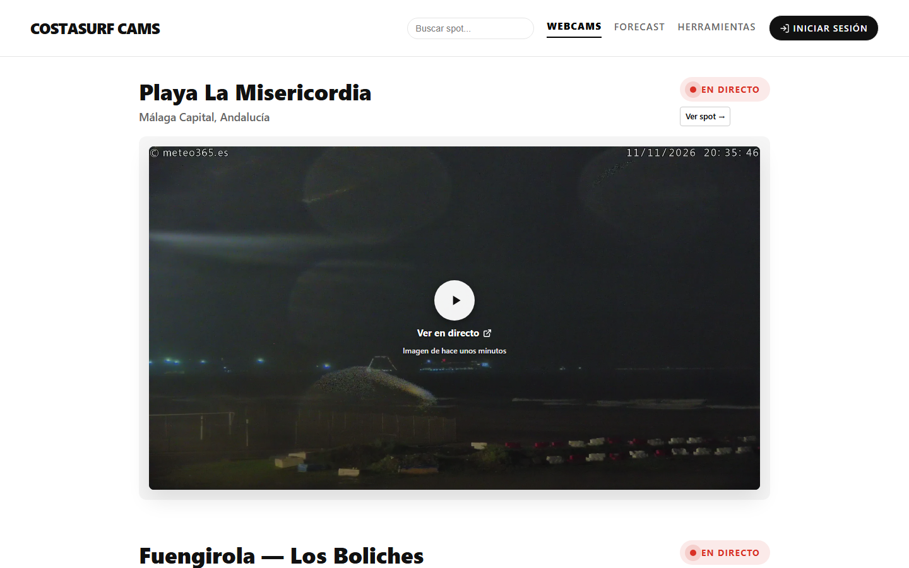
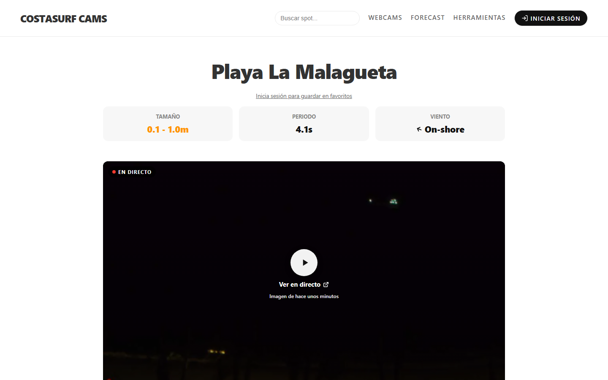
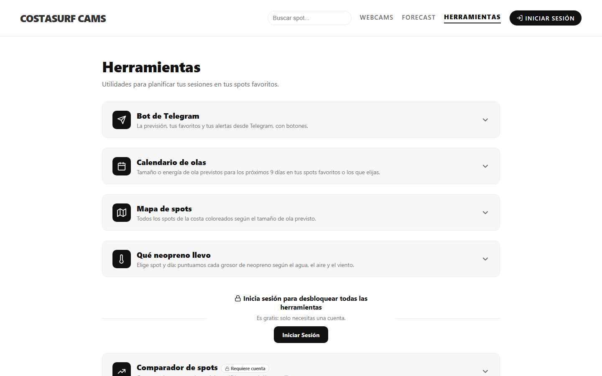
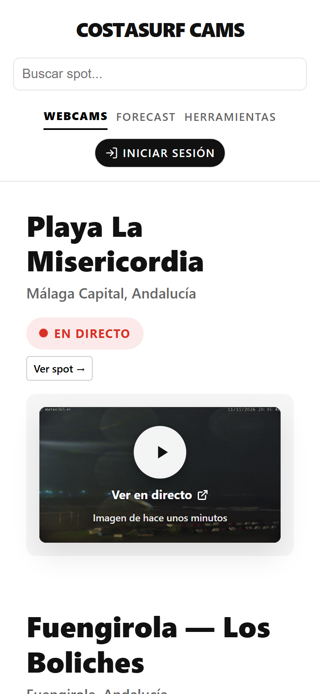

# CostaSurf Cams

A website that brings together webcams and surf conditions for surfers in Málaga.

Live demo:
```text
[costasurfcams.netlify.app](https://costasurfcams.netlify.app)
```


## Features

- Watch your favorite webcams live
- Find your next surf spot on a map
- Receive notifications when there are waves at your spots
- Filter between spots
- Decide which wetsuit thickness to use
- Save your favorite spots

## Screenshots

| Spot page with forecast | Tools |
| --- | --- |
|  |  |

<p align="center">
  
  <br>
  <em>Mobile version</em>
</p>

## Technologies used in the project

- HTML
- CSS
- JavaScript

## My contribution

The project was developed using Claude Code as a programming assistant. I was responsible for the product design, feature definition, testing, iteration and deployment.

## Future improvements

- Embedding the webcams directly on the website
- Getting a commercial license for a better forecast API

## Learning objectives

With this project I developed knowledge about:

- HTML
- Problem solving
- Proxies
